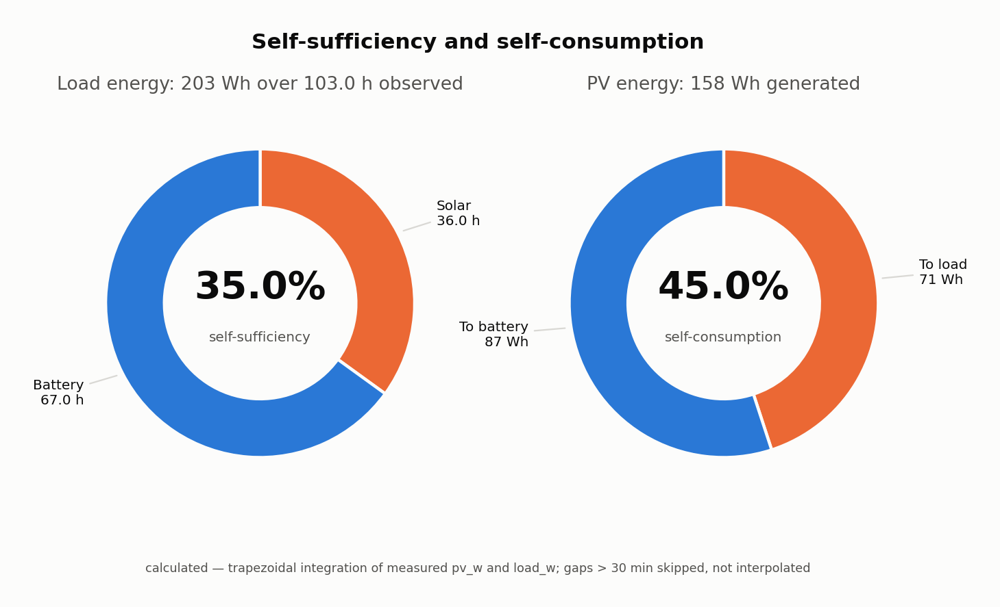
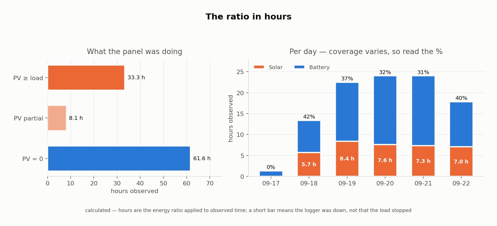
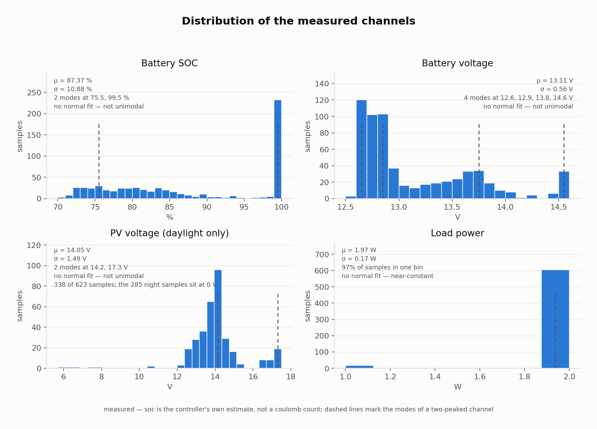
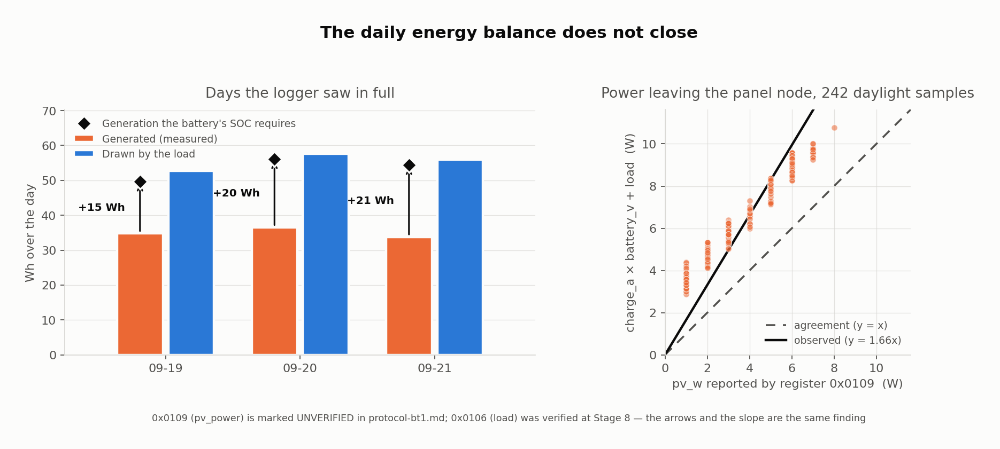

# Solar Monitor — ESP32 ⇆ Renogy BT-1 Gateway

Low-power remote data-acquisition platform for a solar experiment. An **ESP32**
acts as a local IoT gateway: it reads a **Renogy Wanderer 10A** charge controller
over **Bluetooth Low Energy** via the **Renogy BT-1** module, then forwards
timestamped measurements over **Wi-Fi** to a server that publishes a dashboard at
`solar.example.com/solar`.

```
Renogy Wanderer 10A
      │  (RJ12 comms port)
Renogy BT-1
      │  Bluetooth Low Energy
   ESP32  ──────── local IoT gateway
      │  Wi-Fi (outbound HTTPS/MQTT only)
  Internet
      │
solar.example.com/solar   (auth-protected dashboard)
```

## Status

Current stage: **Stage 1 — Identify the exact ESP32 variant.**
See [`docs/stages.md`](docs/stages.md) for the full 13-stage roadmap and
acceptance criteria. Nothing in `server/` is built yet — by design.

## Design philosophy (non-negotiable)

1. **Validate incrementally.** Do **not** build web/cloud infrastructure before
   confirming reliable BLE communication between the ESP32 and the Renogy BT-1
   (Stages 4–8).
2. **Label data provenance.** Every value is one of:
   *manufacturer spec* · *measured* · *calculated* · *estimate* ·
   *experimental observation*. See [`docs/data-model.md`](docs/data-model.md).
   Nominal panel power (10 W) and battery capacity (7 Ah / 12 Ah) are
   **specifications**, never measured results.
3. **Security first.** The ESP32 is never exposed to the public Internet. It only
   makes **outbound** connections. No router port-forwarding to the ESP32.

## Hardware (primary platform)

- **ESP32** dev module — primary gateway (see [`docs/hardware.md`](docs/hardware.md))
- Renogy Wanderer 10A PWM charge controller
- Renogy BT-1 Bluetooth module (plugs into the Wanderer's RJ12 comms port)
- SSD1306 0.91″ OLED status display, and a DHT11 for air temperature +
  humidity (wiring: [`docs/hardware.md`](docs/hardware.md#air-temperature--humidity-dht11))

Secondary/experimental only: Raspberry Pi Pico W, Arduino UNO R4 WiFi.
**Do not** assume Raspberry-Pi Linux/Python BLE libraries port to the ESP32.

## Experimental goal

Compare two configurations under timestamped, retained logging:

| Config | Panels | Batteries |
|--------|--------|-----------|
| 1 | 1 × 10 W | 2 × 12 V / 7 Ah AGM |
| 2 | 2 × 10 W | 2 × 12 V / 12 Ah AGM |

Data is retained for later analysis in Python / MATLAB / Excel.

## History analysis

`analysis/plot_history.py` reads a CSV exported from the dashboard
(`/api/export.csv`) and writes the figures below. Run it after any logging
window:

```bash
python3 -m pip install --user -r analysis/requirements.txt   # once
python3 analysis/plot_history.py --fetch                     # or --csv data/history.csv
```

`--fetch` reads the dashboard credentials from `~/.netrc`; they are never stored
in the repo. The exported CSV lands in `data/`, which `.gitignore` keeps out of
version control.

It follows the dashboard's own integration method: trapezoidal over the measured
`pv_w` and `load_w`, with intervals longer than 30 min **skipped rather than
interpolated**, so a logger outage under-reports instead of inventing energy.

### The two ratios

<picture>
  <source media="(prefers-color-scheme: dark)" srcset="docs/figures/ratios-dark.png">
  
</picture>

### The same ratio in clock time

<picture>
  <source media="(prefers-color-scheme: dark)" srcset="docs/figures/hours-dark.png">
  
</picture>

Because the load is a near-constant 2 W, the energy ratio maps almost exactly
onto clock time — 33.3 h of full PV coverage plus 8.1 h of partial coverage
(worth 2.7 h) gives the 36.0 h that 35% of 103 h predicts. That equivalence is a
property of a flat load, not a general one; it will break as soon as the load
varies.

### Distribution of the measured channels

<picture>
  <source media="(prefers-color-scheme: dark)" srcset="docs/figures/distributions-dark.png">
  
</picture>

**None of these channels is Gaussian, and the script will not pretend otherwise.**
It tests each one and draws a normal fit only where the shape supports it:

| Channel | Shape | Why |
|---|---|---|
| Battery SOC | 2 modes (75.5%, 99.5%) | absorption/float plateau vs the overnight discharge band |
| Battery voltage | 4 modes (12.6, 12.9, 13.8, 14.6 V) | resting, bulk, absorption and float are distinct operating points |
| PV voltage (daylight) | 2 modes (14.2, 17.3 V) | clamped to the battery while charging; near open-circuit when not |
| Load power | 97% in one bin | the load is a fixed ~2 W draw |

μ and σ are still printed as descriptive statistics, but for a multi-modal
channel they describe no state the hardware actually occupies — 13.11 V is a
voltage this battery is rarely *at*.

### Observations from the first window (2026-09-18 → 09-22, config 1)

| Quantity | Value | Provenance |
|---|---|---|
| Observed | 102.99 h of a 117.04 h span (3 gaps, 14.05 h) | `calculated` |
| Production | 157.91 Wh | `calculated` |
| Consumption | 203.04 Wh | `calculated` |
| Self-consumed | 71.03 Wh | `calculated` |
| Self-sufficiency | 35.0% = 36.0 h | `calculated` |
| Self-consumption | 45.0% | `calculated` |
| Daily generation | 35.1 Wh/day, mean of the 3 days with ≥90% coverage | `calculated` |
| Best day | 36.5 Wh (09-20) | `calculated` |
| Implied pack capacity | 1.52 Wh per SOC point → ~152 Wh ≈ 11.9 Ah at 12.8 V | `estimate` |
| Runtime at SOC 87%, 2 W | ~66 h to empty, ~51 h to a 20% floor | `estimate` |

Days are **local-time days, split at midnight and allocated pro rata**. A solar
day is a local day — bucketing by UTC at UTC−6 would cut each day's sunlight
across two buckets — and charging a midnight-spanning interval wholly to the day
it started in let a day total more than 24 h of observation. Partial days are
never scaled up to 24 h, so the per-day rate averages only days that clear 90%
coverage; the script says so rather than quoting a rate built from partial days.

Two cautions on that window:

- **The 35% is pessimistic.** The 11.93 h gap on 09-18 (04:06→16:02) covers most
  of a daylight period, so production went unrecorded while the load did not.
  That is why consumption exceeds production over the window even though SOC
  *rose* from 84 to 87.
- **The capacity figure is an estimate, not a measurement of the cells.** It
  comes from Wh drawn per SOC point across four PV-zero nights, and the
  controller's SOC is a voltage-derived estimate quantised to 1% — per-night
  implied capacity scattered from 9.1 to 18.7 Ah. Only the aggregate over 76 SOC
  points is meaningful, and it is consistent with config 1's `spec` of
  2 × 7 Ah in parallel (14 Ah nominal) at roughly 85% of nameplate.

### Why the daily balance does not close

<picture>
  <source media="(prefers-color-scheme: dark)" srcset="docs/figures/balance-dark.png">
  
</picture>

On every day the logger observed in full, **the battery ends where it started**
(79→79, 78→77, 81→79). Conservation of energy then says generation must equal
consumption over that day. It does not — measured generation falls short by
**15, 20 and 21 Wh**, a fifth to a third of the day's total.

The per-sample test on the right says why. `data-model.md` asks for `pv_power` to
be cross-checked against `pv_voltage × pv_current`, and it passes that one
(median ratio 1.02). But the stronger check is conservation at the panel node —
everything the panel supplies either charges the battery or runs the load:

```
charge_a × battery_v + load(V × I)  vs  pv_w
  median ratio 1.66 over 242 daylight samples
  -> pv_w reports ~60 % of the power actually flowing
```

`pv_w` comes from register **`0x0109`, which `protocol-bt1.md` still marks
UNVERIFIED**; `charge_a` and the load registers are verified. The two independent
lines of evidence — a daily balance that misses by a third, and a per-sample
ratio of 1.66 — are the same finding, and they point at the one register the
project has not yet confirmed. **Treat every production and self-consumption
figure in this README as a lower bound until `0x0109` is verified at Stage 8.**

A second, smaller defect turned up alongside it: `load_w` is an integer register,
and it reports **2 W for a true 2.18–2.52 W** — `15.3 %` below `load_v × load_a`
across the whole history. Consumption is therefore under-reported too, which
makes the generation gap slightly *worse*, not better. `pv_w` is integer-quantised
the same way (it only ever takes the values 1–8 W).

Both are measurement defects, not physical ones. Nothing here says the panel or
the battery is underperforming — it says two of the registers cannot yet be
trusted to the precision this analysis needs.

### Colour

PV/production is orange and the battery is blue in every figure here, matching
the live dashboard so the two can be read side by side. The hexes differ from the
site's — these figures ship a dark variant and use this palette's own validated
steps — but the measure→hue mapping is shared.

One deliberate exception: the site paints *self-consumed* purple, inherited from
its Energy legend, while the "PV energy — where it went" ring here splits
orange/blue. Violet against blue fails CVD separation on a dark surface
(ΔE 1.9 protan, 9.8 normal vision, both under the floor), so the validated pair
won over cosmetic parity.

## Repository layout

```
solar-monitor/
├── README.md                 ← you are here (project hub)
├── docs/
│   ├── hardware.md           hardware inventory, ESP32 variant analysis
│   ├── architecture.md       data flow, security model, server API
│   ├── protocol-bt1.md       BT-1 BLE protocol notes (UNVERIFIED refs)
│   ├── stages.md             13-stage roadmap + acceptance criteria
│   ├── data-model.md         target fields, units, provenance tags
│   └── figures/              generated plots (light + dark)
├── firmware/
│   ├── README.md             Arduino IDE / board setup, flashing
│   ├── common/               shared config (secrets pattern)
│   ├── stage1_identify/      print chip/flash/BT features
│   ├── stage3_wifi_test/     verify Wi-Fi connectivity
│   └── stage4_ble_scan/      BLE scan, flag likely BT-1
├── analysis/
│   └── plot_history.py       ratios, distributions, energy balance -> docs/figures/
├── server/                   DEFERRED until BLE is proven (Stages 10+)
└── data/                     logged datasets for offline analysis
```

## Quickstart (Stage 1)

1. Install ESP32 board support in Arduino IDE — see [`firmware/README.md`](firmware/README.md).
2. Open `firmware/stage1_identify/stage1_identify.ino`.
3. Select your board, flash, open Serial Monitor at **115200** baud.
4. Record the reported chip model / revision / flash size into
   [`docs/hardware.md`](docs/hardware.md).

## References (community reverse-engineering — to be verified)

Renogy BT-1 has been reverse-engineered by the open-source community. These are
**starting references, not ground truth** — every claim is verified empirically
in Stages 6–8:

- `cyrils/renogy-bt` (Python, Raspberry Pi) — Modbus-over-BLE approach
- `Olen/solar-monitor` / `Olen/renogy-bt2`
- `corbinu/renogy` and related BLE captures

Their transport (Modbus RTU frames over a BLE serial-style service) is documented
in [`docs/protocol-bt1.md`](docs/protocol-bt1.md), flagged UNVERIFIED.

## Author

Built and maintained by **Jose Galaviz** ([@Galaviz1](https://github.com/Galaviz1)),
Paradox Lab — hardware, firmware, the BT-1 protocol work and the dashboard at
[solar.example.com/solar](https://solar.example.com/solar).
