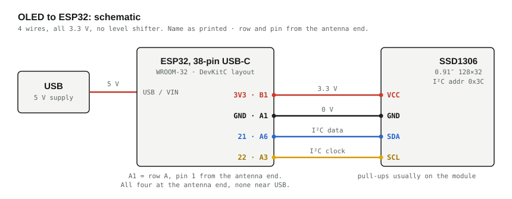
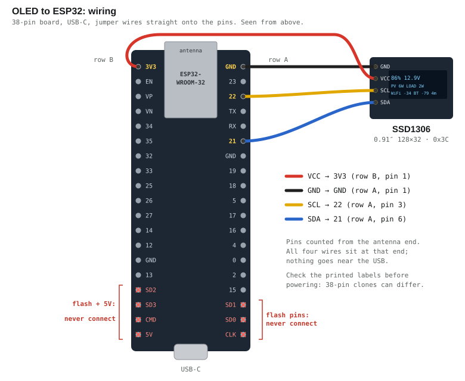
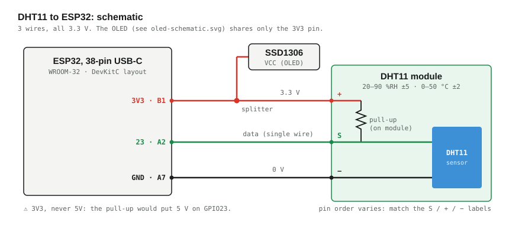
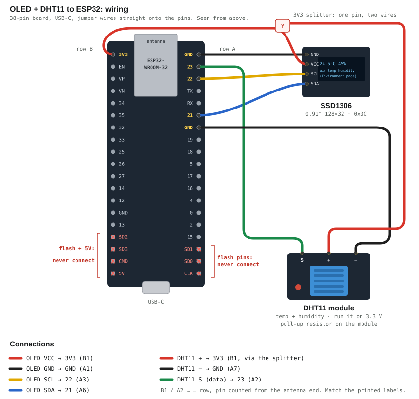

# Hardware

## Primary platform — ESP32

Reported module characteristics (from the user's module documentation —
*manufacturer spec*, to be **confirmed** by Stage 1 firmware):

| Property | Value (spec) |
|---|---|
| GPIO | ~32 pins |
| SPI Flash | 32 Mbit ≈ **4 MB** |
| Bluetooth | **4.2 BR/EDR + BLE** |
| Wi-Fi | 802.11 b/g/n, 2.412–2.484 GHz |
| Buses | UART, SPI, SDIO, I²C, I²S |
| Analog | ADC, DAC |
| Other | PWM, IR |
| Antenna | Integrated PCB, ~2 dBi |
| Security | WPA / WPA2 / WPA2-Enterprise / WPS |
| Serial | 115200 bps |
| Operating temp | −20 °C … +85 °C |
| Storage temp | −40 °C … +90 °C |
| Dimensions | ~25.6 × 50 mm |

### Variant analysis (inference — confirm in Stage 1)

The **Bluetooth 4.2 BR/EDR + BLE** line is diagnostic:

- ESP32-**S3**: BLE 5.0, **no** BR/EDR → excluded
- ESP32-**C3**: BLE 5.0 (RISC-V), no BR/EDR → excluded
- ESP32-**S2**: **no** Bluetooth at all → excluded
- **Original ESP32** (Xtensa dual-core): BT 4.2 BR/EDR **and** BLE → **match**

Combined with 4 MB flash, PCB antenna, and ~25.6 × 50 mm footprint, this is
almost certainly an **ESP32-WROOM-32** on a DevKitC / NodeMCU-32S-class board.

> **✅ CONFIRMED (2026-09-17)** via `esptool flash_id`: chip is **ESP32-D0WD-V3
> rev 3**, 4 MB flash, WiFi + BT/BLE + dual-core — an original ESP32 (WROOM-32
> class). The inference above holds. (The `stage1_identify` Arduino sketch is an
> alternative that additionally prints the SDK version once the toolchain is set
> up in Stage 2.)

#### Stage 1 measured output — CONFIRMED (via esptool 3.3.2, 2026-09-17)

Read directly from the bootloader (`esptool flash_id`), board on
`/dev/cu.usbserial-0001`:

```
Chip model      : ESP32-D0WD-V3   (original ESP32, Xtensa dual-core)
Chip revision   : 3
CPU cores       : 2 (Dual Core)
CPU freq (MHz)  : 240
Crystal         : 40 MHz
Flash size      : 4 MB  (mfr c4 = GigaDevice, device 6016)
Base MAC        : aa:bb:cc:dd:ee:ff
Features        : WiFi, BT (BR/EDR) + BLE, VRef calibration in eFuse
USB-UART bridge : CP2102 (Silicon Labs, VID 0x10c4 / PID 0xea60)
                  -> /dev/cu.usbserial-0001
SDK version     : v5.5.5  (ESP-IDF via Arduino core 3.3.11, read at Stage 2)
```

Conclusion: **ESP32-D0WD-V3**, i.e. an original-ESP32 (WROOM-32 class) module
with 4 MB flash. Matches the pre-hardware inference below.

> **Correction (2026-09-18):** the bridge was first recorded here as a CH340.
> It is a **CP2102** — `system_profiler SPUSBDataType` reports Silicon Labs
> VID `0x10c4` / PID `0xea60`. The port name is the tell: CP2102 enumerates as
> `/dev/cu.usbserial-<chip serial>`, CH340 as `/dev/cu.wchusbserial*`.
> The CP2102 also reports serial `0001`, which is why the port name survives
> moving the board between USB ports.

## Pinout — the board in use: 38-pin, USB-C (DevKitC layout)

**Identified from a photo on 2026-10-05: 19 pins per side and a USB-C
connector.** Earlier versions of this file described a 30-pin DevKit V1, and
the OLED wiring drawn from that pinout put wires on this board's flash pins
(see the correction below). Board identification: **count the pins along one
side** — 19 is this layout, 15 is the 30-pin DevKit V1.

Seen from above, antenna (module) at the top, USB-C at the bottom. Rows are
named by side; pins are counted from the antenna end.

```
               ┌──── antenna / WROOM-32 module ────┐
   B1  3V3      ●                                   ●  GND      A1
   B2  EN       ●                                   ●  GPIO23   A2   VSPI MOSI
   B3  GPIO36 VP●  input only, ADC1_0               ●  GPIO22   A3   I2C SCL
   B4  GPIO39 VN●  input only, ADC1_3               ●  GPIO1    A4   TX0 ← console
   B5  GPIO34   ●  input only, ADC1_6               ●  GPIO3    A5   RX0 ← console
   B6  GPIO35   ●  input only, ADC1_7               ●  GPIO21   A6   I2C SDA
   B7  GPIO32   ●  ADC1_4, touch9                   ●  GND      A7
   B8  GPIO33   ●  ADC1_5, touch8                   ●  GPIO19   A8   VSPI MISO
   B9  GPIO25   ●  ADC2_8, DAC1                     ●  GPIO18   A9   VSPI CLK
   B10 GPIO26   ●  ADC2_9, DAC2                     ●  GPIO5    A10  ⚠ strapping
   B11 GPIO27   ●  ADC2_7, touch7                   ●  GPIO17   A11  TX2
   B12 GPIO14   ●  ADC2_6, touch6 ⚠ strapping       ●  GPIO16   A12  RX2
   B13 GPIO12   ●  ADC2_5 ⚠⚠ must be LOW at boot     ●  GPIO4    A13
   B14 GND      ●                                   ●  GPIO0    A14  ⚠ boot mode
   B15 GPIO13   ●  ADC2_4, touch4                   ●  GPIO2    A15  ⚠ strapping, LED
   B16 SD2  ✖   ●  flash (GPIO9)                    ●  GPIO15   A16  ⚠ strapping
   B17 SD3  ✖   ●  flash (GPIO10)                   ●  SD1  ✖   A17  flash (GPIO8)
   B18 CMD  ✖   ●  flash (GPIO11)                   ●  SD0  ✖   A18  flash (GPIO7)
   B19 5V   ✖   ●  USB 5 V, never into a 3.3 V part ●  CLK  ✖   A19  flash (GPIO6)
               └──────────────── USB-C ─────────────┘
```

> **⚠️ The pins nearest the USB are the flash chip's.** SD0–SD3, CMD and CLK
> (B16–B18, A17–A19) are the SPI flash the ESP32 runs from. Anything on them —
> even an OLED's power pins — corrupts every flash read, and the board
> boot-loops before any firmware starts:
> `rst:0x7 (TG0WDT_SYS_RESET)` with garbage like `load:0x0080001c,len:542902201`
> or `csum err`. That was the "OLED does nothing and the board keeps resetting"
> fault of 2026-10-05.
>
> **Corrected 2026-10-05, twice.** The first version of this file drew a 30-pin
> DevKit V1 with the USB at the wrong end. The second fixed that board's pinout
> ("3V3 is beside the USB") — correct for a 30-pin board, but on this 38-pin
> board the pins beside the USB are 5V and the flash pins. **Match by the
> printed labels**; 38-pin clones can differ from the DevKitC layout above.

### Rules that bite

- **GPIO6–11 do not exist on the header for a reason** — they are wired to the
  SPI flash. Using them crashes the chip.
- **GPIO34, 35, 36 (VP), 39 (VN) are input-only.** No output, no internal
  pull-ups. Fine for sensors, useless for driving anything.
- **⚠️ ADC2 cannot be read while Wi-Fi is active.** This matters for *this*
  project specifically: Stage 10 keeps Wi-Fi up permanently, so **GPIO0, 2, 4,
  12–15, 25–27 are unusable as analog inputs.** Any analog sensor must go on
  **ADC1: GPIO32, 33, 34, 35, 36, 39**.
- **⚠️⚠️ GPIO12 (MTDI) must be LOW at boot.** It selects the flash voltage;
  pulling it high can leave the board unable to boot. Avoid it unless you have
  a reason.
- **Other strapping pins** — GPIO0 (boot mode), GPIO2, GPIO5, GPIO15. They must
  be free to settle at reset; a load on them can stop the board booting or
  break auto-programming.
- **GPIO1/GPIO3 are the serial console.** Anything attached there fights the
  boot log and uploads.
- **Power**: `VIN` is 5 V in (or out, from USB). `3V3` is the regulator output —
  a few hundred mA at best, and this board has already shown it has no supply
  margin to spare (see `firmware/README.md`, brownouts). Do not power servos,
  radios, or anything with an inrush from it.

## OLED status display (SSD1306, 128×32, I²C)

Optional. Shows SOC, battery volts, PV/load power and link health at the rig,
so the system can be checked without opening the dashboard.

| OLED pin | ESP32 pin | Note |
|---|---|---|
| `VCC` | `3V3` (row B, pin 1) | **3.3 V, not 5 V** — this module is a 3.3 V part |
| `GND` | `GND` (row A, pin 1) | |
| `SDA` | `GPIO21` (row A, pin 6) | I²C data (the core's default SDA) |
| `SCL` | `GPIO22` (row A, pin 3) | I²C clock (the core's default SCL) |

Both sides run at 3.3 V, so **no level shifter is needed** — this is the easy
case. (A 5 V-only OLED would need one, and would also need 5 V from the `5V` pin.)



The OLED connects with four female-to-female jumper wires straight onto the
board's header pins — no breadboard. **All four are at the antenna end:**

| OLED pin | ESP32 pin | Position (from the antenna end) |
|---|---|---|
| `VCC` | `3V3` | row B, pin 1 (corner) |
| `GND` | `GND` | row A, pin 1 (corner) |
| `SCL` | `22` | row A, pin 3 |
| `SDA` | `21` | row A, pin 6 |



**Match pins by their printed labels, not by position.** The OLED header comes
in more than one order (`GND VCC SCL SDA` is drawn here; `VCC GND SDA SCL` is
also common), and 38-pin clones don't all follow the DevKitC layout above.

- I²C address is usually **0x3C**; some modules are 0x3D. The serial log prints
  which one it tried and whether it answered.
- Four wires only. The only other GPIO in use is the DHT11's data pin
  (GPIO23, below), so there is no conflict — and note GPIO21/22 are ordinary
  pins, not strapping pins, so they cannot interfere with booting.
- Draw is roughly 10–20 mA, small next to the radios. Given the brownout history
  in `firmware/README.md`, it is still one more reason to stay on a proper
  supply rather than a bus-powered hub.
- Configured in `firmware/stage10_upload/config.h` (`OLED_*`). Setting
  `OLED_ENABLED` to 0 builds it out entirely; leaving it on with no panel
  attached logs `[oled] not found` and carries on, because a missing display
  must never stop the logger.

Layout on 128×32. Two pages in turn: readings for 4 s, then an info page for
2 s (`OLED_PAGE_MAIN_MS`, `OLED_PAGE_INFO_MS` in `config.h`; set INFO to 0 for
one page only):

```
▮▮▮ 86%  12.9V         ParadoxLab Solar
PV 6W  LOAD 2W         39°C  ctrl temp
WiFi -34 BT -79 4m
                        2026-10-07  14:32
```

- Main page: a battery icon filled to the SOC (its next step blinks while
  charging), SOC and battery volts, PV and load power, both RSSIs (dBm) and
  minutes since the last upload.
- Info page: the Wanderer's controller temperature (register `0x0103`, high
  byte; see `protocol-bt1.md`) and the local date and time. The date uses
  `DISPLAY_TZ` (UTC−6, Chihuahua) for the screen only — uploads stay UTC.

The last figure is the useful one: if the age counter climbs past ~11 minutes,
the logger has stopped, and you can see that at a glance.

## Air temperature + humidity (DHT11)

Added 2026-10-14. A **DHT11 module** (hiBCTR 10-pack, Amazon `B0DTKB16MD`:
3.3–5.5 V, 20–90 % RH ±5 %, 0–50 °C ±2 °C) measures the air around the rig.
The firmware reads it every 30 s, shows it on a third OLED page, and uploads it
with each sample as `env_temp` / `env_hum` (see `data-model.md`).

| DHT11 pin | ESP32 pin | Position (from the antenna end) |
|---|---|---|
| `+` (VCC) | `3V3` | row B, pin 1 — **shared with the OLED's VCC** |
| `−` (GND) | `GND` | row A, pin 7 |
| `S` (data) | `23` | row A, pin 2 |





- **3V3, never 5V.** The module's pull-up resistor ties the data line to the
  module's own supply. On 5 V it would hold GPIO23 at 5 V, outside the ESP32's
  rating. On 3.3 V it is a direct, safe connection — no level shifter.
- **One 3V3 pin, two parts.** This board has a single 3V3 pin, already used by
  the OLED. Share it with a **Y (1-to-2) Dupont splitter**, a 3-pin female
  header bridged on the back, or a short breadboard power rail. The DHT11 draws
  about 1–2.5 mA, so the shared supply is no concern.
- **GPIO23 is an ordinary pin**: not a strapping, flash or console pin, so the
  sensor cannot stop the board booting. It is a digital signal, so the ADC2 /
  Wi-Fi rule above does not apply.
- **All three wires stay at the antenna end**, like the OLED's — nothing near
  the flash pins.
- **Match `S` / `+` / `−` by the printed labels**: pin order differs between
  modules (`S + −` is drawn here).
- **Where to put it:** on its cable, away from the ESP32 (which warms itself),
  the controller and direct sun. Inside a sealed box it measures the box.
- **Limits:** the DHT11 is rated 0–50 °C and 20–90 % RH, with ±2 °C / ±5 %.
  Outdoors in winter or in a sun-heated enclosure it can go out of range; a
  **DHT22 / AM2302** (−40–80 °C, ±0.5 °C) fits the same 3 wires — change
  `ENV_DHT_TYPE` in `config.h`, nothing else.
- Configured in `firmware/stage10_upload/config.h` (`ENV_*`). `ENV_ENABLED 0`
  builds it out. With it on and no sensor attached, the log says
  `[env] no reading` and the solar data uploads exactly as before — a missing
  sensor never blocks the logger.

The third OLED page, shown for 2 s after the info page while the sensor is
reporting:

```
     Environment
24.5°C        45%
air temp  humidity
```

### Relevance to this project

Apart from the OLED (I²C, GPIO21/22) and the DHT11 (digital, GPIO23), **no GPIO
is used**. The ESP32 reaches the solar system purely
over BLE via the BT-1 and is deliberately galvanically isolated from the DC side
(see the wiring note below). If that ever changes — a shunt, a thermistor, a
current sensor — use **ADC1 pins only**, because Wi-Fi is always on.

## Renogy hardware

| Item | Notes |
|---|---|
| Renogy **Wanderer 10A** | PWM charge controller, 12 V system |
| Renogy **BT-1** | BLE module; plugs into the Wanderer **RJ12** comms port |

**BT-1 identified (Stage 5, 2026-09-17):**
- BLE name: `BT-TH-XXXXXXXX`
- MAC: `a1:b2:c3:d4:e5:f6`
- RSSI at test location: **~-85 dBm (weak)** — move ESP32 closer to the BT-1 for
  reliable connections in Stages 6–9.

### Important wiring note

The BT-1 connects to the **controller's communication port**, not to the ESP32.
**There is no electrical connection between the ESP32 and the solar/battery
circuit** — the ESP32 talks to the BT-1 purely over BLE. This is intentional and
keeps the ESP32 galvanically isolated from the DC power side.

The BT-1 typically advertises with a name beginning **`BT-TH-`** (to verify in
Stage 4/5).

## Solar / battery under test

*Manufacturer specifications* (NOT measured results):

- Panels: 10 W nominal each (1× in Config 1, 2× in Config 2)
- Batteries: 12 V AGM — 7 Ah (Config 1) or 12 Ah (Config 2), 2× in series/parallel
  (topology to document once wired)

Actual delivered power/energy and true usable capacity are **measured** or
**calculated** quantities produced by this system — see
[`data-model.md`](data-model.md).

## Secondary / experimental platforms

- **Raspberry Pi Pico W** — alternative experimental platform only.
- **Arduino UNO R4 WiFi** — secondary; no native BLE central role suitable for
  the BT-1 without extra hardware. Not preferred unless a specific requirement
  arises.
